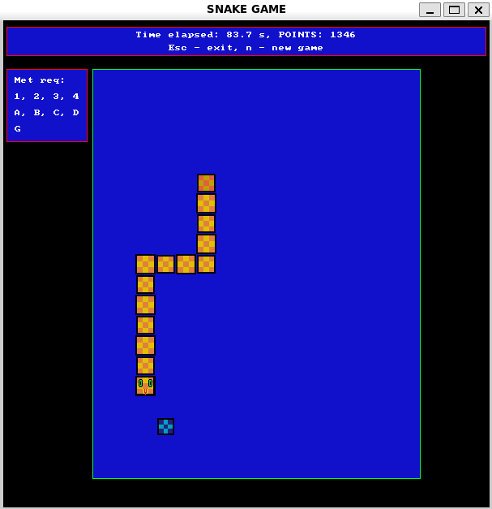

# Snake 🐍

A classic Snake game developed in C++ using SDL2. Control the snake, collect bonuses, avoid collisions, and survive as the game gradually becomes faster.



## Features

- Snake movement, growth, and collision detection
- Increasing difficulty as the game progresses
- Blue collectibles and temporary red bonuses affecting gameplay
- Scoring system and game-over screen
- Custom graphics and visual effects

## Build & Run

**Requirements:** Linux (tested on Ubuntu/WSL), G++, GNU Make, and SDL2.

Install dependencies on Ubuntu:

```bash
sudo apt update
sudo apt install build-essential libsdl2-dev
```

Clone and run:

```bash
git clone https://github.com/Grodek17/Snake_project.git
cd Snake_project
make
./snake
```

## Controls

| Key | Action |
|---|---|
| Arrow keys | Control the snake |
| N | Start a new game |
| Esc | Exit |

## About

Originally developed as a university C++ programming project using a provided SDL2 starter template for window initialization and basic drawing utilities.

The gameplay logic, snake mechanics, bonuses, and scoring system were implemented as part of the project. The original implementation has been largely preserved, while the repository structure, build process, and documentation have been improved.